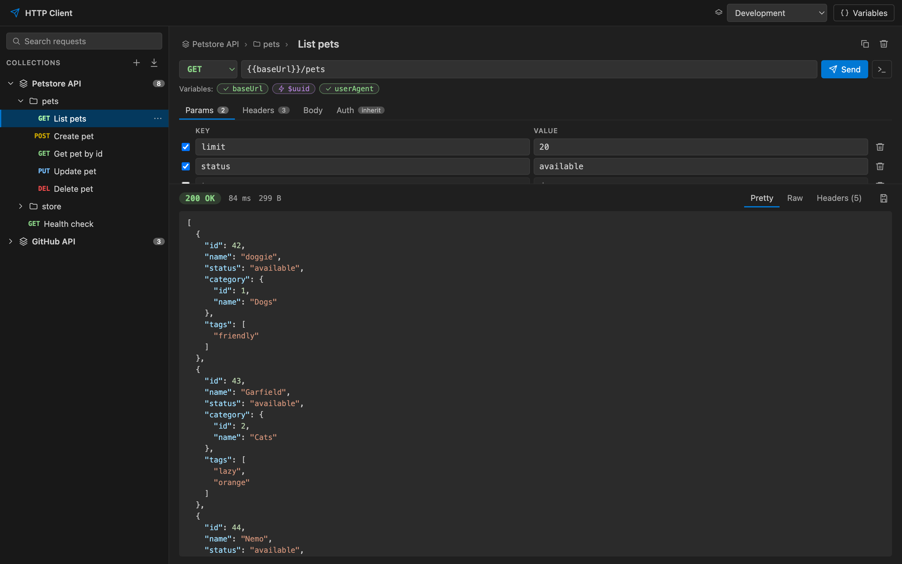
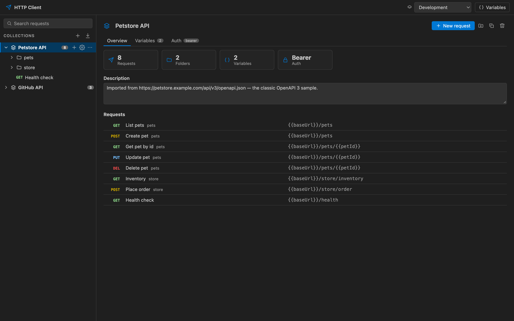
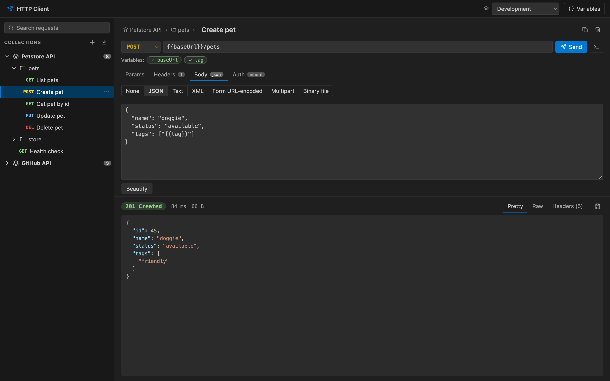
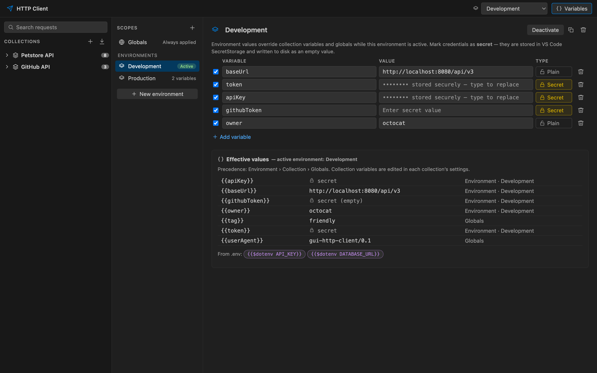
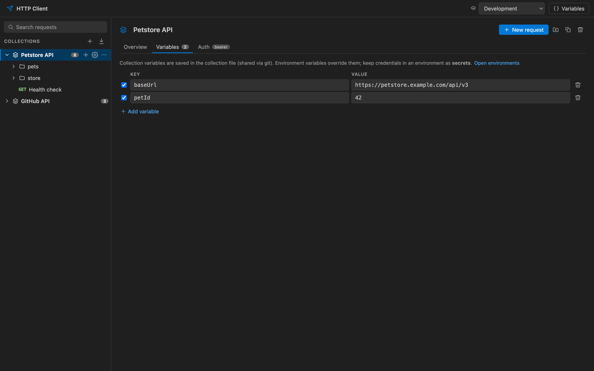
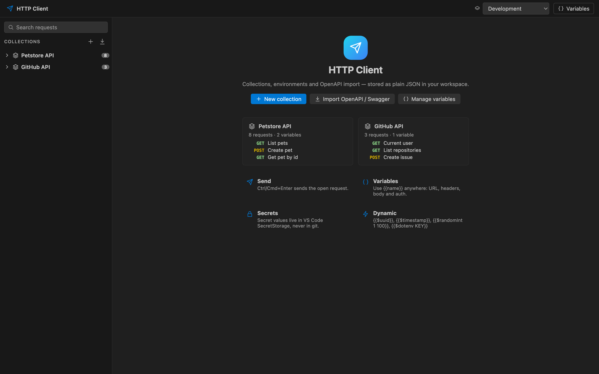
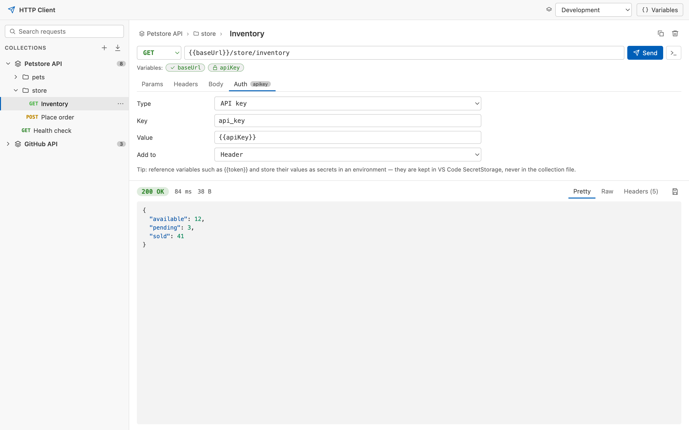

# GUI HTTP Client

A free, open-source API client for VS Code with a full graphical workbench: collections of requests, environments and variables (with secrets), OpenAPI / Swagger import, and a request editor with a pretty-printed response viewer. Everything is stored as plain JSON in your workspace, so collections live in git next to your code.



## Features

- **Workbench.** One editor tab with everything in it: the collections sidebar, the request editor and the response, an environment picker and the Variables manager. Open it from the **HTTP Client** activity bar icon or **HTTP Client: Open HTTP Client** in the Command Palette. The active environment is also shown in the status bar; click it to switch.
- **Collections, folders and requests.** Create, rename, duplicate and delete collections, folders and requests from the sidebar's hover buttons or its `⋯` / right-click menu. Drag and drop requests and folders to reorder them or move them between collections. A search box filters by name, method or URL.
- **Request editor.** Method, URL, query params, headers, body (JSON, text, XML, form URL-encoded, multipart with files, binary file) and auth. Rename a request by clicking its title. **Send** with the button or <kbd>Ctrl</kbd>/<kbd>Cmd</kbd>+<kbd>Enter</kbd>, cancel a running request, or copy it as a `curl` command.
- **Response viewer.** Status, time and size; Pretty (syntax-highlighted JSON), Raw and Headers views; **Save** the body to a file.
- **Variables everywhere.** Use `{{name}}` in the URL, params, headers, body and auth. Chips under the URL show every variable the request uses and whether it is defined, secret, dynamic or missing; click one to jump to the Variables manager.
- **Environments and secrets.** Globals plus any number of environments (Development, Production, …), with one active at a time. Mark a variable as **Secret** and its value is kept in VS Code SecretStorage: the file on disk keeps an empty value, and the value is never sent back to the GUI.
- **Collection settings.** Each collection has an Overview (requests, folders, variables, auth), its own variables, and default auth that requests and folders inherit.
- **Auth.** None, inherit, Basic, Bearer, API key (header or query) and OAuth 2.0 client credentials (the token is fetched and cached automatically).
- **OpenAPI / Swagger import.** Import Swagger 2.0 or OpenAPI 3.0/3.1, in JSON or YAML, from a file or a URL. Tags become folders, the first server becomes `{{baseUrl}}`, parameters and request bodies get example values, and security schemes become auth.
- **Dynamic values.** `{{$uuid}}`, `{{$timestamp}}`, `{{$isoTimestamp}}`, `{{$randomInt 1 100}}` and `{{$dotenv NAME}}` (read from the workspace `.env`).
- **Safe HTTP engine.** Timeouts, a proxy, a TLS verification toggle, a redirect limit (`Authorization` and `Cookie` headers are dropped on cross-origin redirects) and a maximum response size.

## Screenshots

### Collections and requests

Each collection opens on an overview listing its requests, folders, variables and auth. **New request**, **New folder**, **Duplicate** and **Delete** sit in the header, and every row in the sidebar has the same actions on hover.



### Request body and response



### Variables and environments

The Variables manager lists Globals and every environment. Add, rename, duplicate, delete or activate environments, and switch any variable between **Plain** and **Secret**. The **Effective values** table shows which value wins and where it comes from.



Collection variables are edited in the collection's **Variables** tab:



### Welcome screen and light theme

The GUI follows your VS Code theme.





## Variable precedence

When a request is sent, `{{name}}` is resolved in this order (first match wins):

1. Dynamic values (`$uuid`, `$timestamp`, `$isoTimestamp`, `$randomInt`, `$dotenv`)
2. The active environment
3. The request's collection
4. Globals

Unresolved variables are left as-is, and the response shows a warning that lists them.

## Install

The extension is not on the Marketplace yet. Build and install it from source.

### Requirements

- Node.js 22 or newer, and npm
- VS Code 1.100+ or Cursor, with its shell command on your `PATH`:
  - **VS Code:** Command Palette → **Shell Command: Install 'code' command in PATH**
  - **Cursor:** Command Palette → **Shell Command: Install 'cursor' command in PATH**

  Check it with `code --version` or `cursor --version`.

### Steps

```sh
git clone <this-repo-url> gui-http-client
cd gui-http-client
npm install
```

Then install into your editor:

```sh
npm run install:code     # VS Code
npm run install:cursor   # Cursor
```

Each command:

1. runs `npm run package`, which builds a minified bundle and packs it as `gui-http-client-<version>.vsix` in the project root;
2. runs `code --install-extension <vsix> --force` (or `cursor …`), so it also works for upgrading an installed version.

When it finishes, run **Developer: Reload Window** in the editor. The **HTTP Client** icon then shows in the activity bar.

To install the same `.vsix` somewhere else, run `npm run package` and use **Extensions: Install from VSIX…** in that editor, or `code --install-extension gui-http-client-<version>.vsix`.

### Troubleshooting

- **`Could not run "code"` / `"cursor"`:** the editor's shell command isn't on your `PATH`. Install it as described above and open a new terminal.
- **`gui-http-client-<version>.vsix not found`:** packaging failed. Run `npm run package` by itself to see the error.

### Uninstall

```sh
code --uninstall-extension zakout.gui-http-client     # or: cursor --uninstall-extension …
```

## Files

Data is stored in a `.httpclient` folder at the root of the workspace:

```text
.httpclient/
├── collections/
│   └── petstore-api.json      # one file per collection: folders, requests, variables, auth
├── environments/
│   └── development.json       # secret values are written as ""
└── globals.json
```

Commit `collections/` to share requests with your team. Environments are safe to commit too, since secret values never reach the files. Each developer stores their own secrets.

## Settings

| Setting                       | Default    | Description                                                         |
| ----------------------------- | ---------- | ------------------------------------------------------------------- |
| `httpClient.timeoutMs`        | `30000`    | Request timeout in milliseconds (`0` disables it).                  |
| `httpClient.followRedirects`  | `true`     | Follow HTTP redirects automatically.                                |
| `httpClient.maxRedirects`     | `10`       | Maximum number of redirects to follow.                              |
| `httpClient.strictSSL`        | `true`     | Verify TLS certificates. Disable only for local self-signed certs. |
| `httpClient.proxy`            | `""`       | Proxy URL, e.g. `http://proxy:8080`.                                |
| `httpClient.maxResponseBytes` | `52428800` | Maximum response body size to download (bytes).                     |

## Compared with other extensions

| Extension      | Interface | Storage                     | License                 |
| -------------- | --------- | --------------------------- | ----------------------- |
| **This one**   | GUI       | JSON files in the workspace | MIT                     |
| Thunder Client | GUI       | Its own storage             | Freemium, closed source |
| REST Client    | Text only | `.http` files               | MIT                     |
| Bruno          | GUI       | `.bru` files                | MIT                     |

## Development

```sh
npm run build          # bundle the extension and the webview with tsdown
npm run watch          # rebuild on change (F5 starts the Extension Development Host)
npm run preview        # run the GUI in a browser with demo data: http://127.0.0.1:5179
npm test               # unit tests (vitest)
npm run lint && npm run typecheck
```

`npm run preview` serves the webview with a fake extension host (`preview/host.ts`) and reloads on every change. Screenshots are taken from deep links such as `/?shot#request=list-pets&send=1`, `#collection=petstore&tab=variables` or `#variables=dev`; add `&theme=light` to the query for the light theme.

## License

[MIT](LICENSE)
